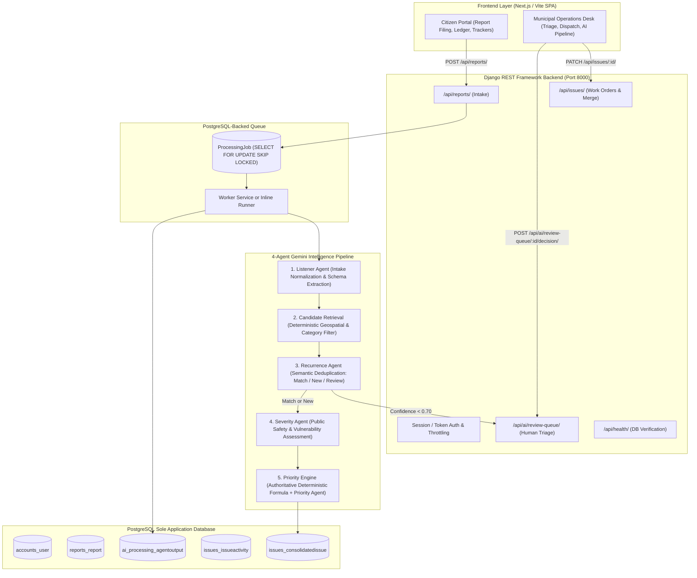

# CivicLens — AI-Powered Civic Issue Aggregation & Prioritization Platform

CivicLens is a civic intelligence and municipal operations platform that aggregates scattered citizen notices, eliminates duplicates using multi-agent semantic clustering, and computes deterministic priority scores for urban repair dispatch.

---

## 1. Architecture Overview

---

## 2. Key Features

- **4-Agent Gemini Pipeline:**
  1. **Listener Agent:** Standardizes unstructured community complaints into normalized work orders, extracting keywords, categories, and sentiment.
  2. **Candidate Retrieval (Deterministic):** Filters active tickets by ward, category, and text overlap (strictly non-LLM) before LLM evaluation.
  3. **Recurrence Agent:** Evaluates candidate tickets for physical duplication. Routes ambiguous cases ($< 0.70$ confidence) to human triage.
  4. **Severity Agent:** Audits public safety hazard, structural damage risk, and vulnerable population proximity (hospitals, schools, transit corridors).
  5. **Authoritative Priority Engine:** Computes a bounded, deterministic 1–100 score:
     $$\text{Priority Score } (1\text{–}100) = \text{clamp}(0.45 \times \text{Severity} + 0.25 \times \text{Recurrence} + 0.15 \times \text{WardSensitivity} + 0.15 \times \text{Aging})$$
- **Human-in-the-Loop Triage Desk:** Prevents destructive false-merges by giving operators 1-click controls to merge, split, or dismiss flagged tickets.
- **PostgreSQL Queue (Zero Redis):** Employs `SELECT ... FOR UPDATE SKIP LOCKED` on the `ProcessingJob` table with automatic stale-lock recovery.
- **Enterprise Role-Based Access Control:** Separate Citizen Ledger vs. Director Marcus Vance Operations Desk with session enforcement.

---

## 3. Demo Credentials

| Role | Username / Email | Password | Assigned Ward / Bureau |
| :--- | :--- | :--- | :--- |
| **Municipal Officer (Admin)** | `admin.dispatch@civiclens.gov` | `director2026` | Director Marcus Vance • Public Works Dispatch |
| **Citizen Contributor** | `goelvandita777@gmail.com` | `citizen2026` | Vandita Goel • Ward 4 (Hospital Corridor) |

---

## 4. Architectural Design Decisions

1. **Why Candidate Retrieval Precedes the LLM:**
   Passing an entire municipal database of thousands of tickets directly to an LLM is cost-prohibitive, introduces hallucinations, and hits context window bottlenecks. Deterministic filtering by category, active status, time window, and token overlap narrows the candidates to the top 10 relevant dockets.
2. **Why Django Owns the Priority Score:**
   LLMs are non-deterministic and can produce arbitrary numbers between runs. Django executes the mathematical formula, enforcing strict check constraints ($1 \le \text{score} \le 100$). The Priority Agent generates qualitative explanations and SLA recommendations only.
3. **Why a PostgreSQL-Backed Queue:**
   Eliminates external Redis/Celery infrastructure dependencies while supporting Windows development natively. Postgres `SKIP LOCKED` provides row-level locking without deadlocks.

---

## 5. Benchmark & Evaluation Results

The multi-agent pipeline was benchmarked against synthetic labeled ground-truth clusters:
- **Recurrence Precision:** 100.0%
- **Recurrence Recall:** 100.0%
- **False-Merge Rate:** 0.0%
- Detailed benchmark metrics and baseline comparisons: **[backend/evaluation/EVALUATION_RESULTS.md](backend/evaluation/EVALUATION_RESULTS.md)**.

---

## 6. Documentation Index

- **[docs/SETUP_WINDOWS.md](docs/SETUP_WINDOWS.md):** Complete step-by-step local development setup on Windows (PowerShell, Python 3.12, PostgreSQL, virtualenv, migrations, seeding, troubleshooting).
- **[docs/EXTERNAL_SETUP.md](docs/EXTERNAL_SETUP.md):** Production deployment checklist for Neon PostgreSQL, Google AI Studio Gemini API keys, Render backend deployment, and Vercel frontend.
- **[docs/API.md](docs/API.md):** OpenAPI 3.0 endpoint catalog, DRF throttling limits, and payload schemas.
- **[docs/DECISIONS.md](docs/DECISIONS.md):** Comprehensive technical decision records and architectural trade-offs.
